# Changelog

## 13-11-2026 (derde sessie, wekelijkse run)

**Gebouwd (op main)**
- **V.8 Geluid en muziek, volledig procedureel:** 28 geluiden (voetstappen, zwaard, treffers, Hollowed, skills, level-up, quest, munten, UI), ambience (zee, wind, meeuwen overdag, krekels 's nachts), verkenningsmuziek in D dorisch met harp en een gevechtslaag die invalt bij gevechten. Volumeschuiven en dempen in het pauzemenu.
- **V.9 Modellen bijgeschaafd:** held met gezicht, haar, vingers, laarzen, riem, cape die achter de held wappert en een uitgewerkt zwaard. Hollowed met schedel, ribbenkast met blauwe gloed en gescheurde lappen. Drie outfits voor dorpelingen. Huizen met luiken, bloembakken en nokbalken.

**Geparkeerd op branch `parkeer/2026-11-13-trap-ui-kerker`** (gebouwd en getest, maar botste met de parallelle sessie die de Undercroft en de actiebalk op main zette):
- V.6a The Warden's Stair: pad om de klif naar een verzegelde deur boven, klif vrij in een kom, navigatie over looproutes, toren met echte botsing.
- V.11 UI-afwerking volgens `docs/UI.md` (paneelstijl, XP-lijn, doelwitbalk met nasleep, itemiconen, skilltree als boom, portretten).
- Een tweede kerker in de toren met minibaas "Warden-Husk Aldric": overlapt met de Undercroft en Aldric, the Lightless Keeper. Voorstel: niet overnemen, of later als verdieping 2 met een andere baas.

**Feedback verwerkt**
- Geen open issues of feedbackbestanden. Live verzoek van de eigenaar: zwaar werk parallel laten doen tot 15:00. Gedaan met vier Fable-subagents (kerker, geluid, UI, modellen) plus één Sonnet-subagent (opslaan).

**Speel het:** https://m4rk4ever-lang.github.io/Fantasy-RPG/

**Screenshots** (van de geparkeerde stand, held en sfeer gelden ook voor main)
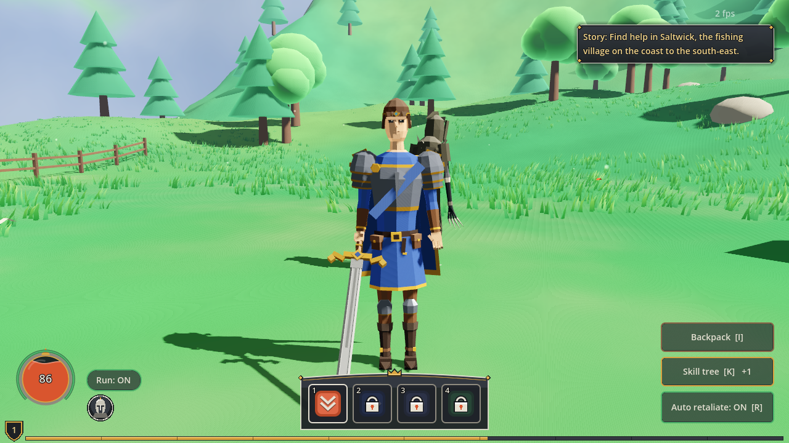

**Zelfcontrole**
- Diepte: ja | Landmark: Veilspire | Palet: ja | Game of demo: game | Zwakste deel: de kom achter de klif op de geparkeerde branch (grijze steile wand); op main de bergring overdag.

**Prestaties:** niet meetbaar hier. Geluid wordt bij de start in ongeveer 0,17 s gegenereerd. Headless 16,7 ms per frame.

**Voorstellen voor SMAAK.md**
- Geluid: "Rustig en episch, modaal, harp en strijkers; gevechtsmuziek alleen tijdens gevechten."

**Problemen en beslissingen**
- Main was tijdens deze run door een andere sessie bijgewerkt (actiebalk, opslaan, Undercroft). Niet geforceerd. Geluid en modellen zijn erop gezet; de rest staat op de parkeerbranch. Eigen opslaan (V.7) vervalt: main heeft al een opslagsysteem.
- Niemand heeft het geluid beluisterd. Graag in de browser luisteren.
- Run eindigde vroeg in verband met het gebruikslimiet.

**Volgende run**
- Trap en UI-afwerking van de parkeerbranch overzetten op main (UI aanpassen aan de nieuwe actiebalk met 8 vakken). Kom achter de klif mooier maken.

## 13-11-2026 (tweede sessie, met de eigenaar live)

Feedback van de eigenaar verwerkt: besturing in RuneScape-stijl, haperingen bij gevechten, lore, een mooiere en levendigere wereld, betere personages en auto retaliate.

**Gebouwd**
- **Camera zoals RuneScape:** draait nooit zelf. Draaien met middelste muisknop (slepen), pijltjes of rechterstick. Zoomen met scrollwiel of + en -. Vrije muiscursor.
- **Klikgevecht met skills (hybride, gekozen door de eigenaar):** klik op een monster: lopen en automatisch aanvallen. Klik op de grond: lopen. Skills op 1 tot 4 met cooldowns en een skillbalk: Cleave, Surge Strike (dash naar doelwit, onkwetsbaar), Whirlwind (draait twee keer rond) en Second Wind (heal). WASD en ontwijken werken nog steeds. Q kiest het dichtstbijzijnde monster.
- **Auto retaliate:** standaard aan, R of de knop rechtsonder. Een stilstaande held vecht terug tegen een monster dat hem raakt.
- **Prestaties:** effecten zitten in pools en materialen worden bij de start voorverwarmd (geen shadercompilatie midden in een gevecht). Treffer-flits op vijanden alleen actief tijdens de flits. Hitstop vertraagt tot 20% in plaats van bijna te bevriezen. Bomen in 5 MultiMeshes, dorp in 2 draw calls.
- **Lore** herschreven: Aldmere gezongen door zeven Ascendanten, zes facties met elk een eigen gelijk, een gewiste zevende god, de speler als neutrale Wachter die moet kiezen.
- **Wereld:** de vallei loopt uit op een baai met zee, golven, schuimranden en strand. Vissersdorp Zoutwijk (Havenhythe als richting): vakwerkhuizen op stenen voeten, steigers met lantaarn, deinende boten, rook, vissenrekken, meeuwen, drie dorpelingen die rondlopen. Stuifmeel en vlinders overdag, vuurvliegjes 's nachts. Een zwevende scherf van de Kroon met runenringen boven de vallei.
- **Geen springen meer:** paste niet bij klik-om-te-lopen. De held stapt zelf over randen tot 0,5 m. Spatie is nu ontwijken. Springblokken bij de arena vervangen door een trap naar een uitkijkplatform.
- **Humor:** dorpelingen zeggen droge zinnen als je dichtbij staat. Het verhaal blijft episch.
- **Leash voor mobs:** Leeghulzen worden agressief binnen 13 m en jagen niet verder dan 16 m van hun thuisplek. Daarna lopen ze terug en genezen ze.
- **Niet in het water:** je stopt aan de waterlijn en kunt niet van de steiger af. Steigers blijven beloopbaar.
- **Klassen en skilltree (keuze-issue #1):** de eigenaar koos A met Priest en Warlock erbij, en C los. Er zijn nu 5 klassen (Vanguard, Ranger, Arcanist, Priest, Warlock). Vanguard is speelbaar met een boom van 3 takken (Blade, Bulwark, Momentum). XP per verslagen Hollowed, levels, 1 skillpunt per level. Skills op de balk worden pas bruikbaar als je ze in de boom vrijspeelt (Cleave heb je vanaf het begin). Karaktervenster met **K** of de knop rechtsonder, met daarin ook je trouw aan een factie (geen invloed op je klasse). XP-balk en level-up-melding in de HUD.
- **Loot en rugzak:** Hollowed laten een buidel met coins, Veil Dust en soms zeldzamere spullen vallen. Rugzak van 28 vakjes (I), eten geneest.
- **Eerste quest met dialoog:** klik op Brenna Gale in Saltwick. Quest "Ashes on the Shore" (5 Veil Dust), met droge humor, beloning in XP, coins en vis. Daarna wijst ze je naar de gedoofde Veilspire. Questlog (L) en tracker rechtsboven.
- **Questlog met duidelijke stappen (feedback):** het verhaal staat in hoofdstukken, elke quest heeft stappen (✓ gedaan, ▸ huidige, ○ nog te doen), de tracker toont je huidige verhaalstap en "!" en "?" hangen boven questgevers.
- **Geen clipping meer door hekken en spullen:** hekken, tonnen, kisten, rekken en palen hebben botsing. Het dorpshek heeft een poort.
- **Padvinding:** klik je ergens, dan loopt de held om huizen, hekken, rotsen en water heen (A* op een raster van 1,25 m, opgebouwd in ongeveer 0,1 s).
- **Rennen aan/uit, geen ontwijken (eigenaar):** Shift, Spatie of de knop "Run". Rennen kost stamina, lopen laadt op. Ontwijken is uit het spel.
- **Spelstructuur (eigenaar):** RPG met MMORPG-gevoel, open wereld, deels lineaire questlijn met dungeons en raids onderweg. Levelen in WoW-stijl met **level cap 60**, een steilere XP-curve en monster-XP die afhangt van het levelverschil. Monsters hebben een level, dat in de doelwitbalk staat. Uitgewerkt in `docs/DESIGN.md` met gebieden per levelbereik. De Veilspire wordt de eerste kleine dungeon.
- **Actiebalk met 8 vakken (feedback):** toetsen 1 tot 8. Sleep skills uit de skilltree (K) of eten uit de rugzak (I) erop, sleep tussen vakken om te wisselen, rechtsklik om te legen. Eten op de balk toont hoeveel je er nog hebt. Klaar voor potions zodra die er zijn.
- **Opslaan en laden:** de voortgang wordt elke 20 seconden en bij het wegklikken van het tabblad automatisch opgeslagen in de browser. In het pauzemenu staan "Save game" en "New game (erase save)". Bewaard worden level, skills, trouw, rugzak, quests, actiebalk, instellingen en positie.
- **Eerste dungeon: Undercroft of the Veilspire.** De deur ligt aan de voet van de rots. Binnen is het donker en grimmig, met fakkels, Hollowed en eindbaas Aldric, the Lightless Keeper (fase 2: roept extra Hollowed op). Met het baken aansteken sluit je hoofdstuk I af en brandt het licht boven de Veilspire weer.
- **UI-ontwerp:** nieuw document `docs/UI.md` met stijlregels, schermindeling en de verfijnde versie van alle HUD-onderdelen (vraag van de eigenaar). De eerste stappen zijn gebouwd: een health-orb met golvende vloeistof en een stamina-boog, en een radiale cooldown op de skillbalk.
- **Alles Engels in het spel:** in-game tekst was al Engels. Nu zijn ook alle namen officieel Engels (Saltwick, Warden's Vale, the Veil, the Hollowed, the Saltbound enzovoort), met een namenlijst in `docs/DESIGN.md`. Bij het binnenlopen van een gebied verschijnt de naam in beeld.
- **Roadmap:** nieuwe koers. Eerst een verticale slice van het eerste gebied (klassen en skilltree, XP en loot, quest met dialoog, opslaan, geluid, modellen bijschaven), pas daarna de wereld uitbreiden.
- **Personages:** held, dorpelingen en Leeghulzen opnieuw opgebouwd als gefacetteerde low-poly lichamen met echte verhoudingen (naar de anatomie-referentie). Held met kuras met goudrand, gelaagde schouderstukken, tabard, cape met franje en een sierlijk zwaard met gloeiende steen. Leeghulzen mager en gebogen, met gescheurde gewaden en klauwen.

**Feedback verwerkt**
- `feedback/` (tekstbestand 1): framedrops, RuneScape-camera met zoom, klikgevecht met skills, lore met goden en facties, omgeving statisch en niet mooi, Havenhythe. Zie `feedback/verwerkt/2026-11-13-feedback.md`.
- `feedback/` (beelden): anatomie, sfeer, uitrusting. Zie `feedback/verwerkt/2026-11-13-beelden.md`.
- `feedback/` (tekstbestand 2): auto retaliate, springen eruit, humor toegestaan. Zie `feedback/verwerkt/2026-11-13-auto-retaliate.md`.
- `feedback/feedback` (richting): leash, water blokkeren, eerst eerste gebied af, klassen en skilltree later, modellen later bijschaven. Zie `feedback/verwerkt/2026-11-13-richting.md`.

**Speel het:** https://m4rk4ever-lang.github.io/Fantasy-RPG/

**Screenshots**
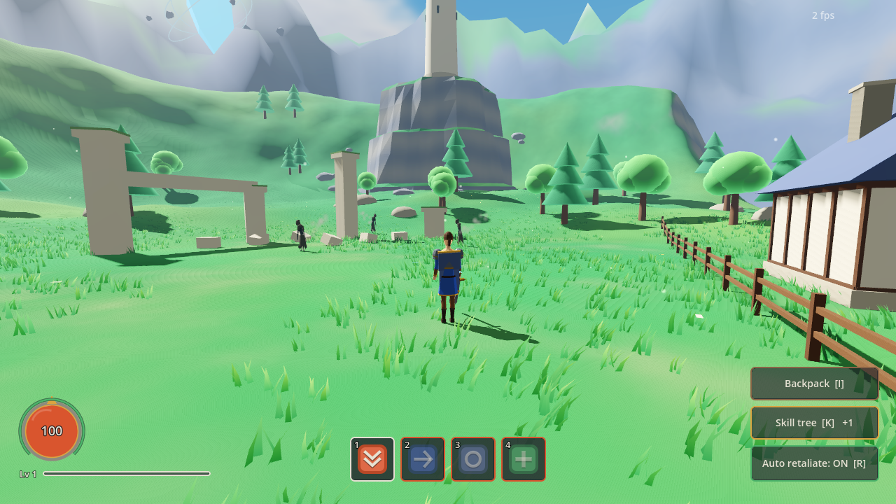
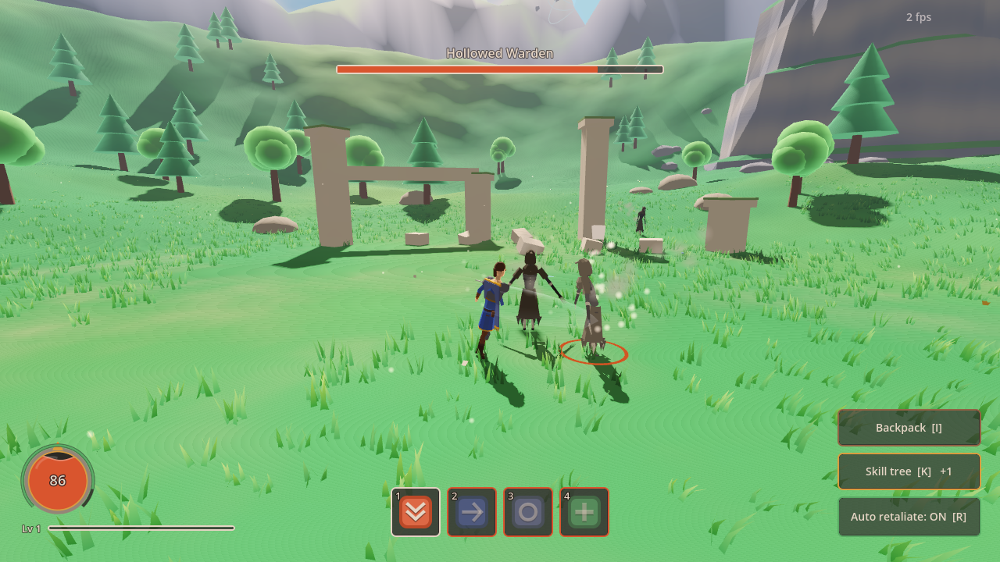
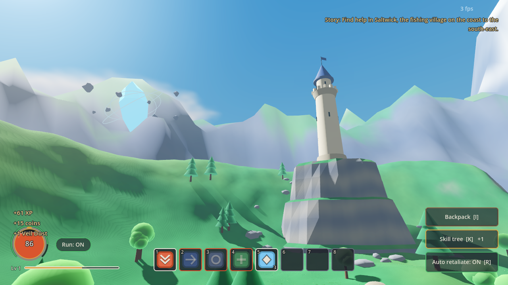
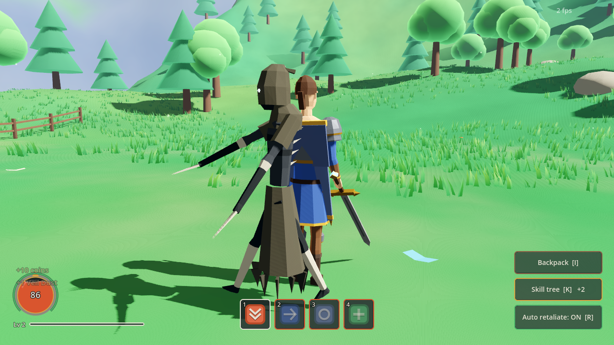
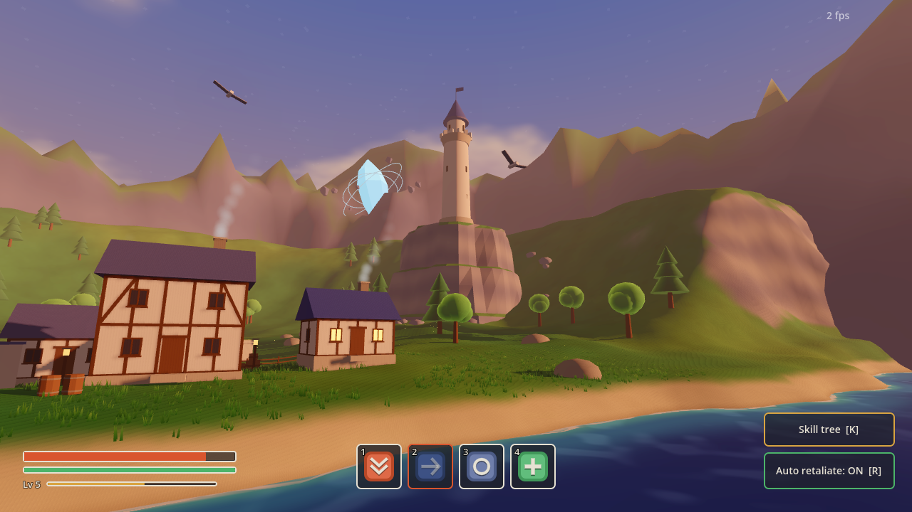
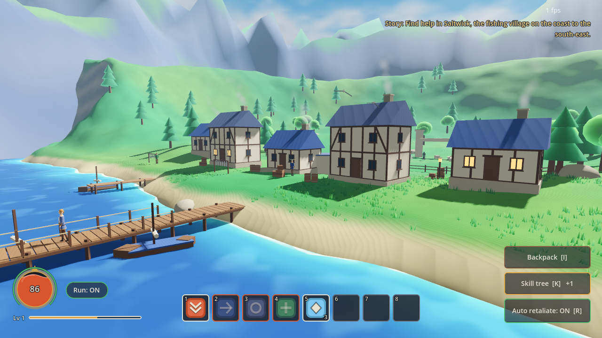
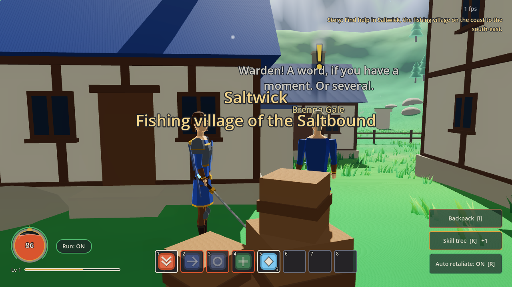
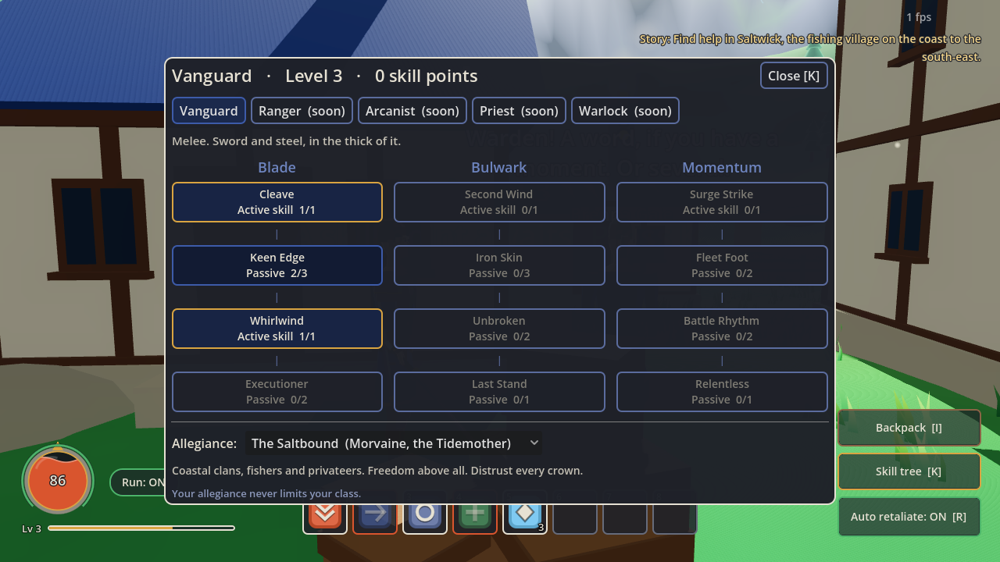
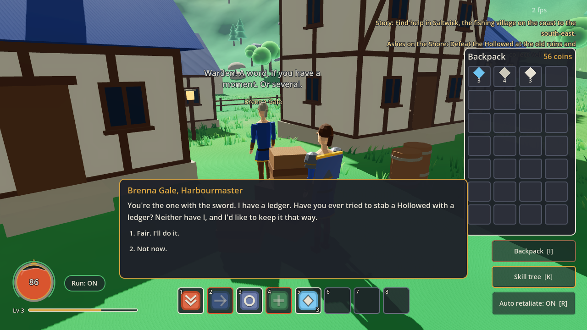
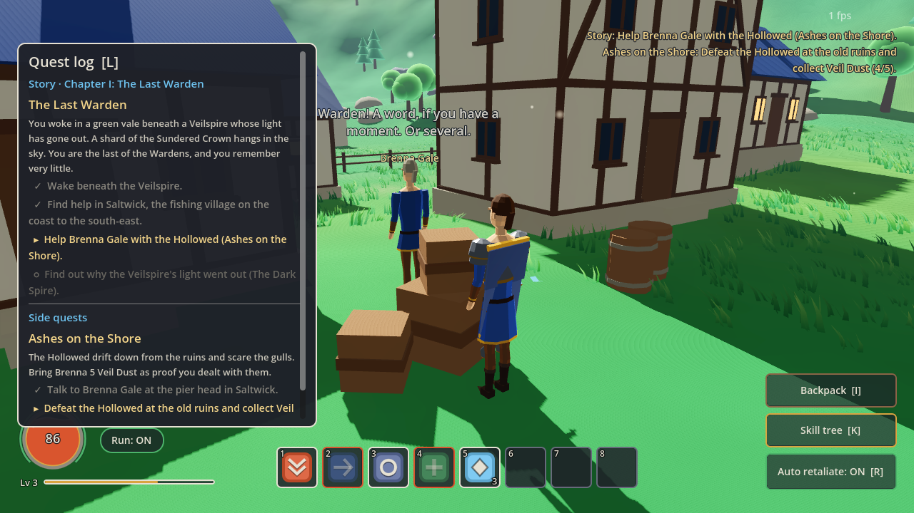
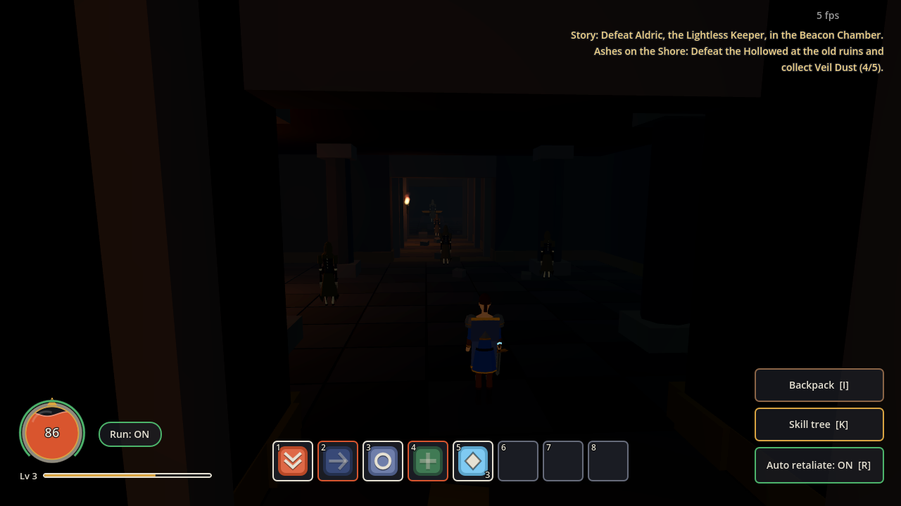
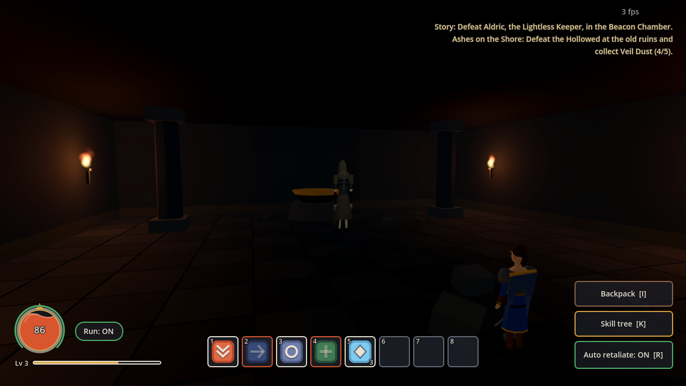
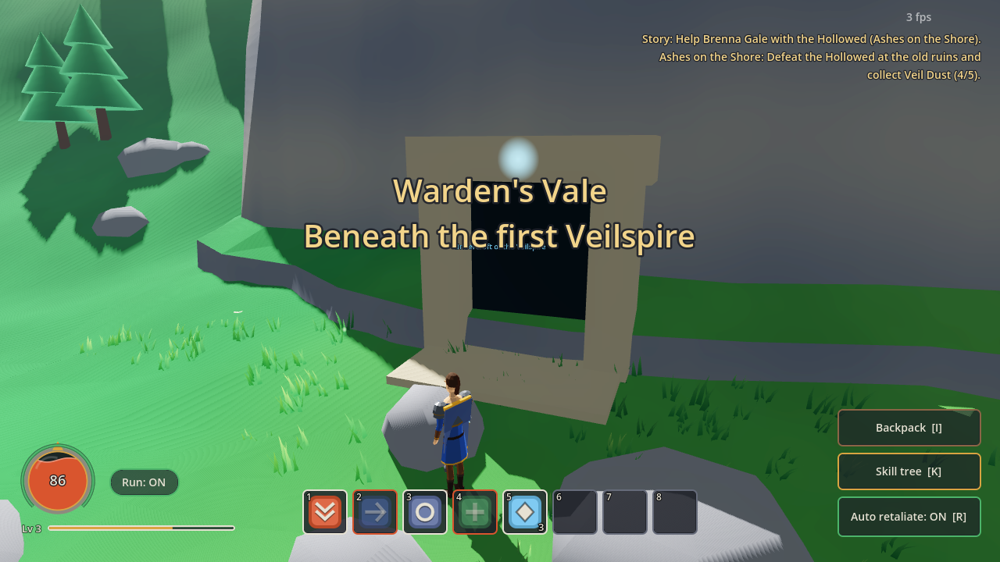

**Zelfcontrole**
- Diepte: ja, sterk in het dorpsbeeld (steiger, huizen, heuvels, bergen). | Landmark: Veilspire en de zwevende kroonscherf. | Palet: ja. Koningsblauwe daken, steenkleurige muren, hemelblauw water. Gras van dichtbij is nog wat fel. | Game of demo: game. Het dorp en de avond zien eruit als een spel. | Zwakste deel: het gras dichtbij (fel en egaal) en de bergring overdag.

**Prestaties:** hier niet te meten (software-rendering). De web-build start zonder fouten in headless Chromium. Draw calls flink omlaag door MultiMesh en samengevoegde meshes. **Graag testen op je laptop of de haperingen bij treffers weg zijn.**

**Voorstellen voor SMAAK.md**
- Onder **Gevecht** de nieuwe richting vastleggen: "Hybride RuneScape-stijl: klik op monsters om aan te vallen, skills op 1-4, auto retaliate. Ontwijken en WASD blijven mogelijk." Nu staat er alleen "snel en vloeiend, combo's".
- Onder **Grafische stijl**: "Personages als gefacetteerde low-poly lichamen met echte verhoudingen."
- Een regel voor de camera: "Camera draait niet zelf mee, de speler draait en zoomt (RuneScape)."
- Onder **Sfeer per gebied** eventueel de kust en Havenhythe als referentie toevoegen.
- Onder **Toon**: "Serieus en episch, met af en toe een grap" in plaats van "weinig humor".
- Onder **Gevecht**: "Geen springen; de held stapt zelf over kleine randen."
- Onder **Gevecht**: de regel "Ontwijken moet altijd kunnen en aanvallen onderbreken" vervangen door "Geen ontwijken, zoals RuneScape en WoW. Rennen is een schakelaar."

**Problemen en beslissingen**
- Gevecht in RuneScape-stijl botst met SMAAK.md ("combo's, veel beweging"). Gevraagd aan de eigenaar en gekozen voor hybride: klik en skills, met behoud van ontwijken en combo's.
- Het eerste beeld (Elden Ring-artwork) is later door de eigenaar vervangen. Alleen als sfeer gebruikt, niets nagemaakt. Let op: officiële artwork van andere games in een publieke repo kan auteursrechtelijk beschermd zijn.
- Land ligt nu 1,3 m hoger (`LAND_BASE`) zodat het strand alleen aan de kust ligt. Trappen en ruïnes staan nu op de terreinhoogte.
- Gedelegeerd: skillbalk (Sonnet, ging goed) en een samenvatting van de Havenhythe-wikipagina (web-fetch). Daarmee 3 subagents in deze run.
- Haperingen konden we hier niet meten. De oorzaak die het meest voor de hand lag (shaders compileren bij het eerste vonkje of de eerste flits in WebGL, plus de bijna-bevriezing van de hitstop) is aangepakt.

**Volgende run**
- Bevestiging van de eigenaar over de prestaties. Zo nodig: schaduwen en grasdichtheid achter een kwaliteitsinstelling.
- V.4c uitrusting (zichtbaar op de held), V.6b pad naar het torenterras, V.8 geluid. Keuze-issues: resource per klasse (V.12) en raids (V.13).

## 13-11-2026

Eerste run. Repo opgezet en de speelbare kern van fase 1 gebouwd, plus twee blokken uit fase 2 (gras en hemel) omdat de tijd het toeliet.

**Gebouwd**
- Werktitel **Veilspire: The Sundered Crown**, met lore op hoofdlijnen in `docs/DESIGN.md`.
- `docs/SMAAK.md` aangemaakt met de inhoud van de eigenaar.
- Godot 4.7.2 (Compatibility-renderer), web-export single-threaded, GitHub Actions bouwt, test en publiceert naar GitHub Pages. Labels `feedback`, `keuze`, `gedaan` aangemaakt via een workflow.
- Third-person controller: lopen, sprinten, springen (coyote time, buffer, variabele hoogte), dash met i-frames en luchtdash. Momentum via acceleratie.
- Camera: SpringArm3D met botsing, muis en gamepad, FOV-kick bij sprinten en ontwijken, trauma-shake.
- Procedurele held in het palet (koningsblauw, leisteenblauw, staal) met loopcyclus, leunen en squash en stretch, alles in code.
- Gevecht: lichte combo van 3 slagen, zware slam met schokgolf, 2 luchtaanvallen, combo-buffer, zachte auto-aim, ontwijken annuleert altijd. Stamina blokkeert aanvallen nooit.
- Treffergevoel: hitstop, vonken met flits, zwaardspoor, camera shake, knockback, witte treffer-flits op vijanden.
- Eerste vijand: **Hollowed Warden** (Leeghuls) met state machine en duidelijke telegraph. Komt na 7 seconden terug.
- Lock-on met marker, doelwissel via muis- of stick-flick, vijandbalk bovenin de HUD.
- Pauzemenu (hervatten, besturing, gevoeligheid, herstarten) en schade-flits.
- Testvallei: terrein met kliffen en heuvels, Veilspire op een klif, ruïnes met boog, bergring met grote sneeuwtop, bomen met wind.
- Hemel-shader met wolken, zon, maan en sterren. Dag-nachtcyclus (16 minuten). Gras met wind (14.000 plukjes, MultiMesh). Stof bij sprinten, landen en ontwijken.
- Map `feedback/` met uitleg, op verzoek van de eigenaar.
- Na de eerste zelfcontrole: de ronde klif onder de Veilspire vervangen door een gefacetteerde rots met grasrichels en losse rotsblokken aan de voet. Mist iets lichter, zodat de bergring meer vorm houdt.

**Feedback verwerkt**
- Geen open feedback-issues.
- Verzoek van de eigenaar tijdens de run: map `feedback/` aangemaakt (met `README.md` en `verwerkt/`). Werkwijze vastgelegd in README en ROADMAP zodat volgende runs de map ook lezen.

**Speel het:** https://m4rk4ever-lang.github.io/Fantasy-RPG/

**Screenshots**
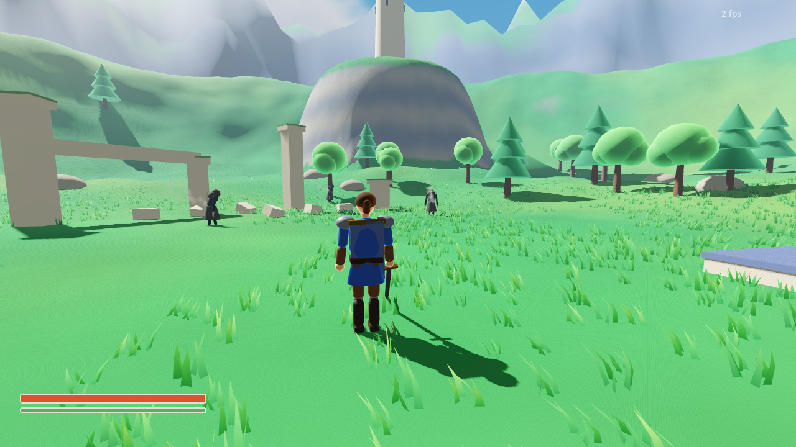
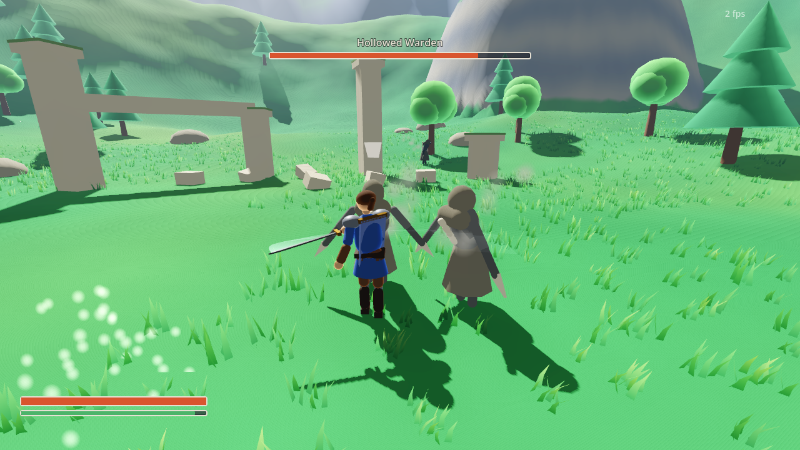
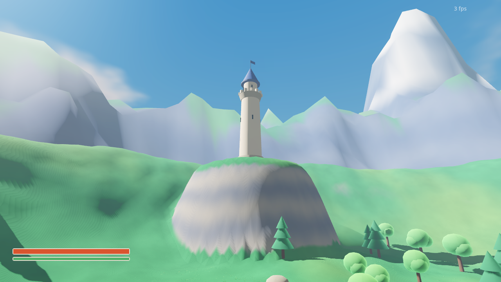
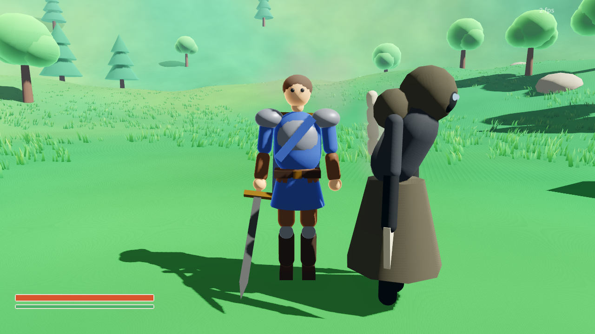
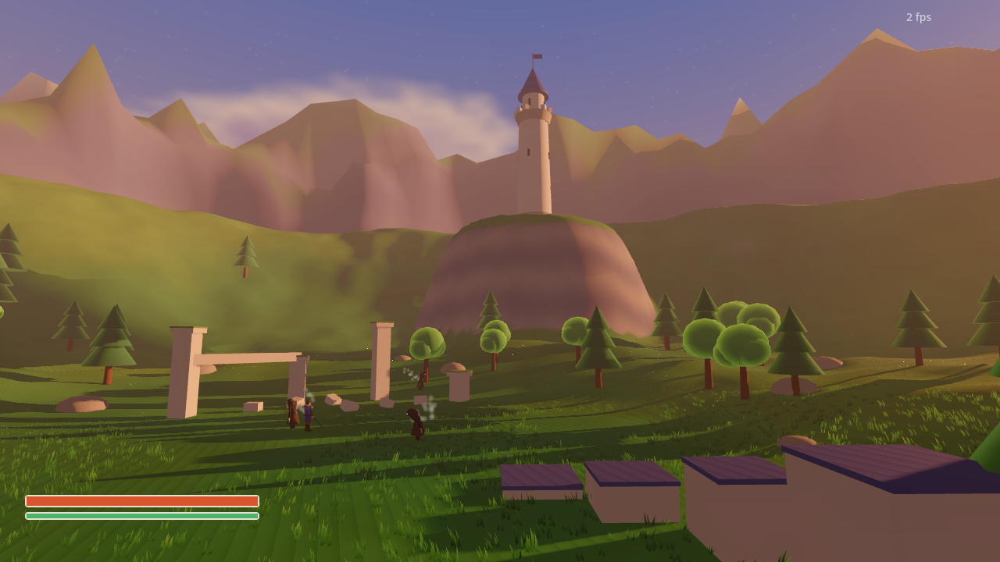

**Zelfcontrole**
- Diepte: ja. Gras en held voor, ruïnes en bomen in het midden, klif, toren en bergring achter. | Landmark: ja, de Veilspire op de klif, ook van ver zichtbaar. | Palet: grotendeels. Held en toren volgen het palet. Overdag is het gras iets te licht mintgroen en de bergen te grijs-wit. | Game of demo: eerder game, vooral het avondbeeld en het gevechtsbeeld. Het daglicht oogt nog wat vlak. | Zwakste deel: eerst de klif onder de toren (een ronde kei). Die is in dezelfde run vervangen. Nu is de bergring overdag het zwakst: te grijs-wit en vlak. Staat bovenaan de roadmap.

**Prestaties:** niet betrouwbaar te meten hier (alleen software-rendering, 2 tot 3 fps). Headless physics draait op de 60 Hz-limiet (16,7 ms per frame). De web-build start zonder fouten in headless Chromium. Graag een meting op een echte laptop.

**Voorstellen voor SMAAK.md**
- Geen.

**Problemen en beslissingen**
- Godot 4.7.2 is de nieuwste stabiele versie in `godotengine/godot-builds`. Vastgelegd in DESIGN.md.
- De rooktests vonden een echte bug: hitstop kon blijven hangen (tijd op 3%) als de timer net te vroeg afging. Opgelost met een real-time check elke frame, plus een test.
- Labels kon ik niet direct aanmaken. Opgelost met de workflow `.github/workflows/labels.yml`.
- Roadmap licht aangepast: blok 2.2 en 2.4 naar voren gehaald, omdat chunk-streaming (2.1) pas zin heeft als de wereld groter wordt. 1.6 en 2.2 gesplitst.
- Vijanden botsen niet met de held, zodat je met een dash door ze heen kunt. Aggro-afstand 13 m zodat je bij de start even rust hebt.
- Gedelegeerd: pauzemenu en vijandbalk in de HUD aan een Sonnet-subagent. Ging goed. Code nagekeken, werkt met de echte vijand.
- Geen keuze-issue deze run. Het eerste grote keuzemoment is de opzet van de character creator (fase 3).
- Geen externe assets. Alles is procedureel.

**Volgende run**
- Bergring overdag meer leisteenblauw en vorm. Pad omhoog naar de Veilspire.
- Blok 1.6b: ontwijk-nabeeld, betere idle-pose, gezicht van de held.
- Daarna fase 2: terreinshader (2.2b), water (2.3).
